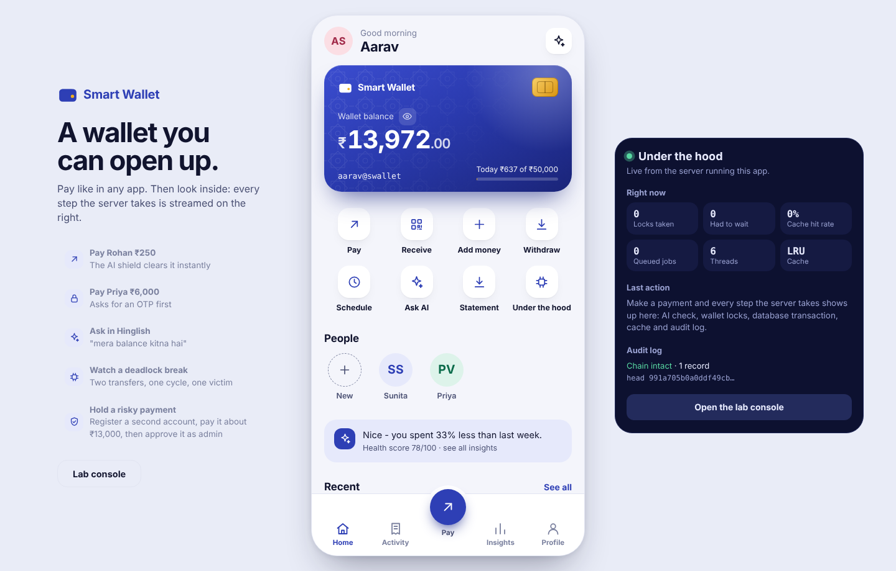
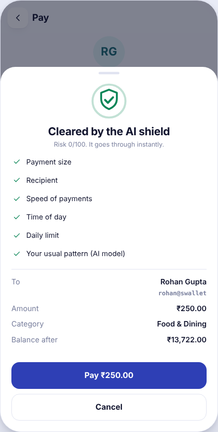
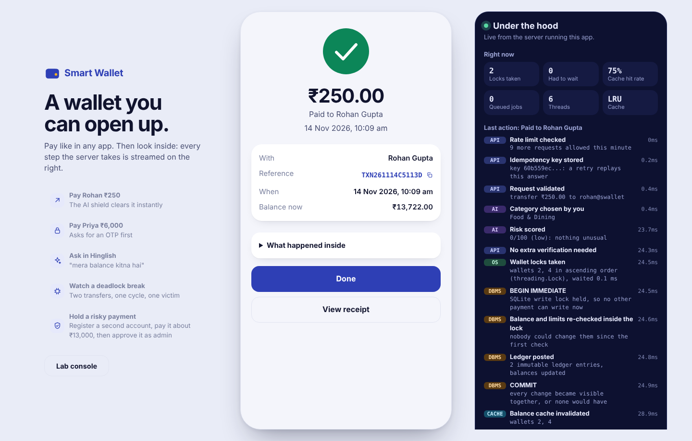
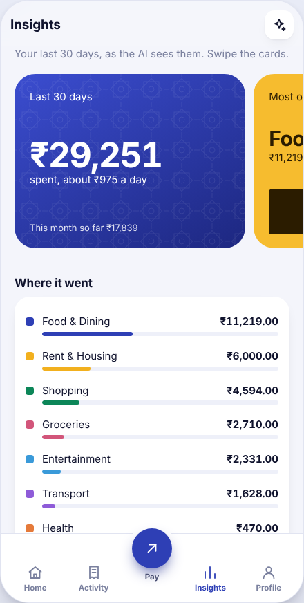
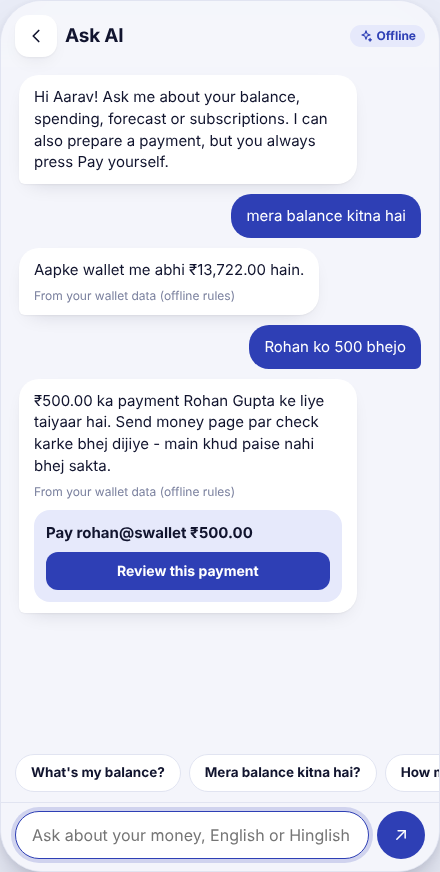
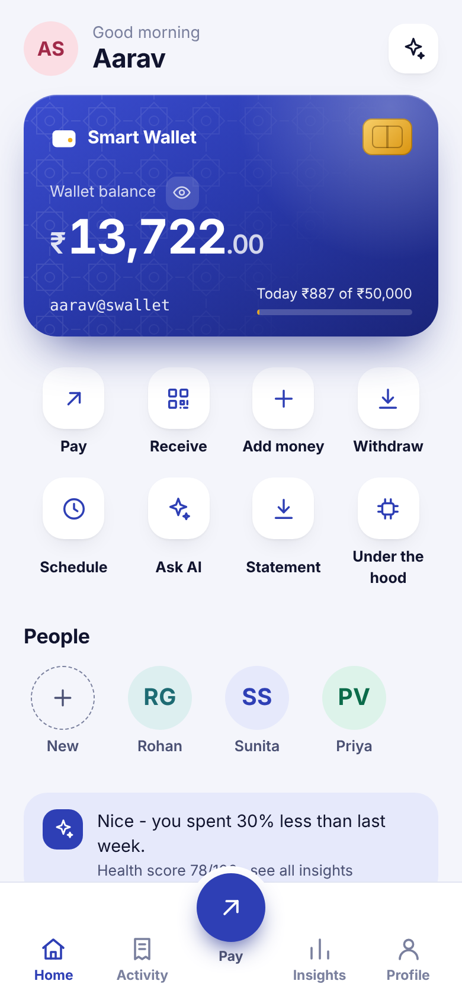
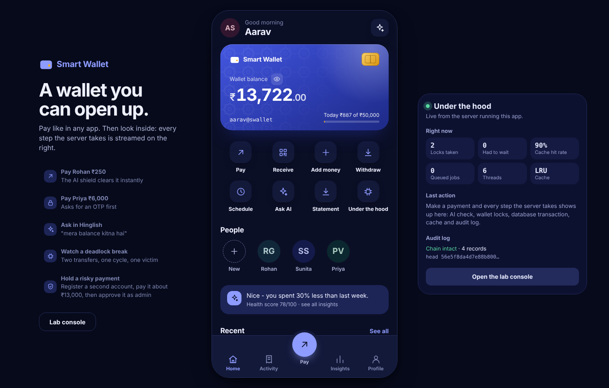
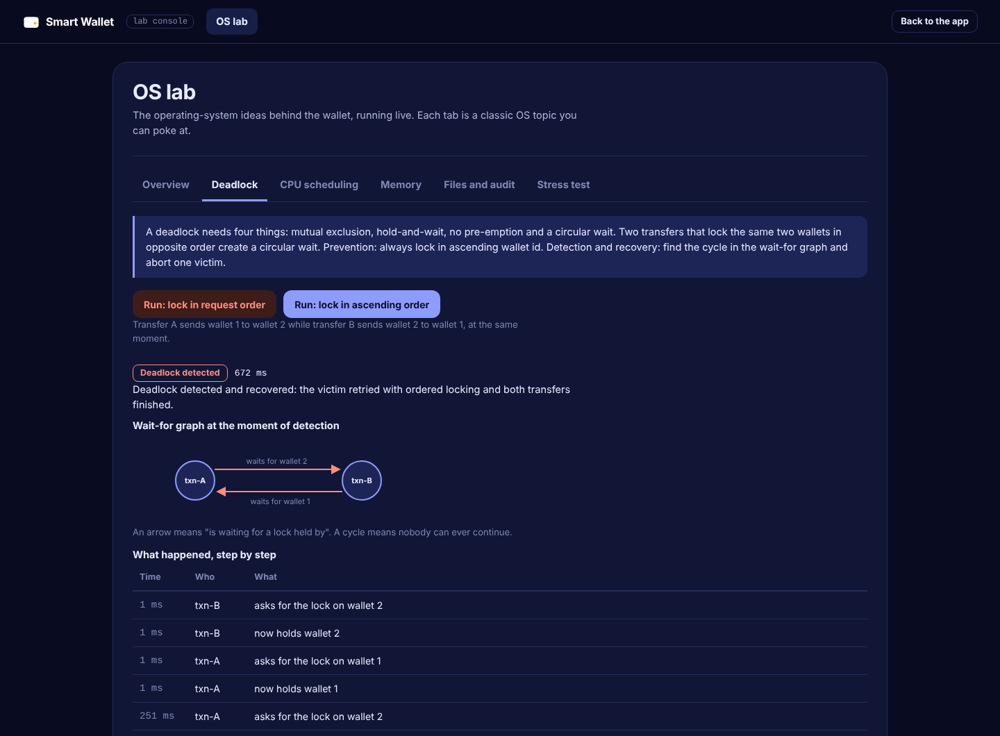
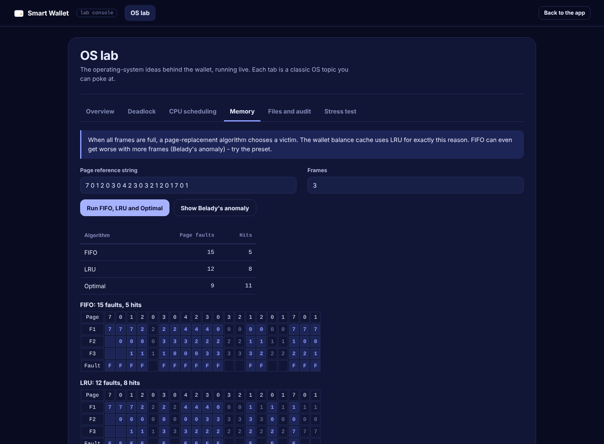

# Smart Digital Wallet & Payment Transaction Management System

A complete **DBMS + Operating Systems** project: a UPI-style digital wallet that looks and behaves like a real payments app,
with a ledger-based database, real concurrency control, an **AI layer** (fraud shield, expense categoriser, spending forecast,
English/Hinglish assistant), and a unique **"Under the hood"** panel that streams every lock, transaction and log write the
server performs while you pay. It runs with one command and needs no build step.



| AI shield review | Receipt + live trace | Insights |
| --- | --- | --- |
|  |  |  |

| Ask AI (Hinglish) | Phone layout | Dark mode |
| --- | --- | --- |
|  |  |  |

| Lab console: deadlock demo | Lab console: page replacement |
| --- | --- |
|  |  |

## Quick start

Python 3.10 or newer.

```bash
python -m venv .venv
# Windows:        .venv\Scripts\activate
# macOS / Linux:  source .venv/bin/activate
pip install -r requirements.txt
python run.py
```

Open **http://127.0.0.1:5000**. The first run creates demo data (17 accounts, ~250 transactions over 75 days).
On a phone, open the same address on your network (`HOST=0.0.0.0 python run.py`) and use "Add to Home screen": it installs like an app.

| Role | Email | Password |
| --- | --- | --- |
| Student (main demo user) | `aarav@wallet.test` | `Demo@1234` |
| Friends | `rohan@wallet.test`, `priya@wallet.test`, `neha@wallet.test` | `Demo@1234` |
| Admin | `admin@wallet.test` | `Admin@123` |

The sign-in screen has one-tap demo buttons. Optional extras: **Redis** (`docker run -p 6379:6379 redis:7`, or
`docker compose up --build` for app + Redis) is detected automatically; without it everything falls back to in-memory versions.
Reset all data: `python manage.py reset`.

## The app

The interface is a phone-width app (full screen on a phone, a centred phone frame on a laptop) with a bottom tab bar:

* **Home**: a wallet card printed with a jaali (lattice) pattern, balance with hide/show, today's limit, quick actions
  (Pay, Receive, Add money, Withdraw, Schedule, Ask AI, Statement), people, an AI tip and recent activity.
* **Pay**: pick a person or merchant, type the amount on the keypad, add a note (the AI suggests a category), and a review sheet
  runs the **AI shield** (size, recipient, speed, time of day, daily limit, pattern model) before you confirm. Payments needing
  verification ask for a 6-box **OTP**; risky ones are *held for review*.
* **Activity**: payments grouped by day with filters and search, a receipt for each payment (status journey written by database
  triggers, AI risk card, category you can correct so the AI learns), CSV statement.
* **Insights**: swipeable "story" cards (spend, top category, 7-day forecast, health score, recurring payments) and details.
* **Ask AI**: English and Hinglish ("mera balance kitna hai", "Rohan ko 500 bhejo"). It can pre-fill a payment, never send one.
* **Profile**: wallet ID and **QR code** to receive money, limits, scheduled payments, light/dark theme, hide balance.
* **Under the hood** (docked on wide screens, a sheet on phones): the server's step-by-step trace of your last payment
  (API, AI, OS locks, DBMS transaction, cache, audit log) plus live lock, cache and queue counters and the audit chain status.
* **Lab console** (separate dark console): deadlock demo, CPU scheduling, memory, files and audit, stress test, and the admin tools.

## What is inside

**Safety**: OTP for payments of Rs 5,000 or more *and* whenever the AI sees medium risk, daily limit, maximum balance,
rate limits, idempotency keys (a retried request never pays twice), frozen accounts, AI-held payments reviewed by an
administrator, and a tamper-evident audit log.

**AI** (all work offline; Claude is optional)
1. *Payment risk engine* - transparent rules + an Isolation Forest; the score and plain-English reasons appear before you pay.
2. *Expense categoriser* - Naive Bayes written from scratch; learns when you correct a category.
3. *Insights* - category breakdown, 7-day forecast, month-end projection, spending spikes, recurring payments, health score.
4. *Ask AI* - English + Hinglish intent detection over your own data; open-ended questions go to Claude if a key is set.

**DBMS**: 3NF schema, integer-paise money, append-only double-entry ledger, triggers, views, reconciliation, indexes,
ACID transactions with `BEGIN IMMEDIATE`, WAL, practice queries in `sql/queries.sql`.

**OS** (live in the Lab console and in Under the hood): mutual exclusion, ordered locking, deadlock detection + recovery with a
wait-for graph, Redis distributed lock, producer/consumer priority scheduler, CPU-scheduling simulator (FCFS, SJF, SRTF,
Priority, RR), LRU cache and page-replacement simulator (FIFO, LRU, Optimal, Belady's anomaly), append-only audit file with
`fsync` and a hash chain, online backups, `os.stat` file facts, and a multi-thread stress test.

More detail: [docs/ARCHITECTURE.md](docs/ARCHITECTURE.md) (ER diagram, payment sequence, front-end design, concept map) and
[docs/VIVA_QA.md](docs/VIVA_QA.md) (22 likely viva questions with short answers).

## Five-minute demo script

On a laptop the left panel has these as clickable shortcuts.

1. **Sign in** with "Try the demo as Aarav". Move the mouse over the wallet card; tap the eye to hide the balance.
2. **Pay Rohan Rs 250** ("dinner split"). Watch the AI shield tick through six checks, confirm, then look at the right panel:
   rate limit, idempotency key, AI risk score, wallet locks, `BEGIN IMMEDIATE`, ledger, `COMMIT`, cache, audit record.
3. **OTP step-up**: pay Priya Rs 6,000. Enter a wrong code (the boxes shake), then the right one (shown in demo mode and printed in
   the server console).
4. **AI hold**: register a second account in a private window ("Zara Test"), then pay `zara@swallet` about Rs 13,000 from Aarav
   (add money first if needed). The shield turns red with reasons; choose *Send for review*. Sign in as **admin** -> Admin
   console -> approve it.
5. **Receipt**: open the payment, change its category (the AI learns), note the status journey written by triggers.
6. **Ask AI**: "mera balance kitna hai", "is mahine food par kitna kharcha hua", then "Rohan ko 500 bhejo" -> *Review this payment*.
7. **Insights**: swipe the story cards; look at the forecast bars and recurring payments (Netflix, Jio recharge, hostel rent).
8. **Schedule** Rs 120 to `neha@swallet` "In 1 minute (demo)", priority 1; keep the Scheduled screen open and watch it run.
9. **Lab console**: *Deadlock* (run both buttons), *CPU scheduling* -> Compare all policies, *Memory* -> Belady's anomaly,
   *Stress test* with "request order" vs "ascending", and (as admin) *Files and audit* -> Create backup, Tamper demo.
10. **Database**: `python manage.py sql sql/queries.sql` and `python manage.py check` (reconciliation, hash chain, integrity).
11. **Tests**: `pip install -r requirements-dev.txt` then `python -m pytest` (59 tests; Redis tests run only if a server is on
    localhost:6379). Optional browser test: `pip install playwright && playwright install chromium && python tests/ui_smoke.py`.

## Project layout

```
run.py  manage.py  requirements.txt  .env.example  Dockerfile  docker-compose.yml
app/
  __init__.py        application factory: wires services, routes, security headers, error handling
  config.py  util.py  security.py  db.py  schema.sql  seed.py
  routes/            auth.py  wallet.py  ai.py  oslab.py  admin.py        (REST API)
  services/
    ledger.py        payment rules: limits, risk check, OTP, idempotency, atomic posting, scheduling, live trace
    locks.py         LockManager (deadlock prevention/detection) + RedisLock + WalletLocks
    cache.py  ratelimit.py  sessions.py  audit.py  scheduler.py  queries.py  trace.py
    ossim.py         CPU scheduling + page replacement simulators
    oslab.py         deadlock demo, stress test, system info, files, backups
  ai/                fraud.py  categorizer.py  insights.py  assistant.py  llm.py
static/              index.html  manifest.webmanifest  icon.svg
  css/               app.css (the "Neel" app theme)  console.css (dark lab console)
  js/                main.js (router)  ui.js  icons.js  sheet.js  keypad.js  flow.js (AI-shield payment flow)  done.js
                     hood.js (Under the hood)  trace.js  charts.js  qr.js  rows.js  api.js  state.js  theme-init.js
    views/           auth  home  pay  money  activity  txn  insights  ask  profile  scheduled  receive  oslab  admin
    vendor/qrcode.js MIT-licensed QR encoder (qrcode-generator)
sql/queries.sql      14 practice queries (joins, window functions, CTE, EXPLAIN)
tests/               59 pytest tests + ui_smoke.py (real-browser test, optional)
docs/                ARCHITECTURE.md  VIVA_QA.md  screenshots/
```

## Configuration

Everything has a default. Copy `.env.example` to `.env` to change anything.

| Setting | Default | Meaning |
| --- | --- | --- |
| `USE_REDIS` / `REDIS_URL` | `true` / `redis://localhost:6379/0` | Redis is used only if it answers; otherwise in-memory fallbacks |
| `DEMO_MODE` | `true` | Also return the OTP to the browser (otherwise it is only printed on the server console) |
| `AUTO_SEED` | `true` | Create demo users and history when the database is empty |
| `OTP_THRESHOLD_PAISE` | `500000` | OTP needed from this amount, in paise (Rs 5,000) |
| `DEFAULT_DAILY_LIMIT_PAISE`, `MAX_TOPUP_PAISE`, `MAX_TRANSFER_PAISE`, `MAX_BALANCE_PAISE` | `5000000`, `5000000`, `5000000`, `20000000` | Rs 50,000 daily limit, Rs 50,000 per top-up / transfer, Rs 2,00,000 wallet cap |
| `HOST`, `PORT` | `127.0.0.1`, `5000` | Where the dev server listens |
| `WALLET_DATA_DIR` | `./data` | Database, audit log and backups live here |
| `ANTHROPIC_API_KEY`, `ANTHROPIC_MODEL` | empty, `claude-sonnet-5-5` | Optional Claude answers in *Ask AI* |

All other limits (rate limits, OTP expiry and attempts, cache size, scheduler workers) are listed in `app/config.py` and can be
overridden the same way.

### Turning on Claude in "Ask AI" (optional)

Put `ANTHROPIC_API_KEY=your-key` in `.env` and restart. Structured questions (balance, spending, forecast...) are still
answered by the offline rules so numbers are exact; open-ended questions go to Claude with a compact summary of *your own*
data. If the call fails the offline assistant answers. Model names change over time - check Anthropic's docs and set
`ANTHROPIC_MODEL` if needed.

## API overview

All endpoints are under `/api`, JSON in and out. Send `Authorization: Bearer <token>` (from login). Money endpoints accept an
`Idempotency-Key` header and return a `trace` array describing what the server did.

| Area | Endpoints |
| --- | --- |
| Auth | `POST /auth/register`, `/auth/login`, `/auth/logout`; `GET /auth/me` |
| Wallet | `GET /wallet`; `POST /wallet/topup`, `/wallet/withdraw`, `/wallet/transfer/preview`, `/wallet/transfer`, `/wallet/transfer/confirm`; `GET /recipients/lookup?q=`, `/recipients/recent`, `/merchants` |
| History | `GET /transactions` (`q`, `type`, `direction`, `category`, `status`, `from`, `to`, `limit`, `offset`), `/transactions/export.csv`, `/transactions/<ref>`, `/transactions/<ref>/timeline`; `PATCH /transactions/<ref>/category` |
| Scheduled | `GET/POST /scheduled`, `DELETE /scheduled/<id>` |
| AI | `GET /ai/insights`, `/ai/model`; `POST /ai/chat`, `/ai/categorize` |
| OS lab | `GET /os/overview`, `/os/audit/verify`; `POST /os/deadlock`, `/os/stress`, `/os/cpu`, `/os/paging`; admin: `GET /os/files`, `POST /os/backup`, `/os/audit/tamper-demo`, `/os/cache/flush` |
| Admin | `GET /admin/overview`, `/admin/alerts`, `/admin/users`, `/admin/reconcile`; `POST /admin/alerts/<id>/approve\|reject`, `/admin/users/<id>/freeze\|unfreeze`, `/admin/ai/retrain` |

```bash
TOKEN=$(curl -s localhost:5000/api/auth/login -H 'Content-Type: application/json' \
        -d '{"email":"aarav@wallet.test","password":"Demo@1234"}' | python -c "import sys,json;print(json.load(sys.stdin)['token'])")
curl -s localhost:5000/api/wallet/transfer -H "Authorization: Bearer $TOKEN" -H 'Content-Type: application/json' \
     -H 'Idempotency-Key: demo-1' -d '{"to":"rohan@swallet","amount":"120.50","note":"chai"}'
# run the same command again: you get the same txn_ref and the money moved only once
```

## Honest limitations

* This is an educational system, not a licensed payment service. OTPs are simulated (printed on the console; returned to the
  browser while `DEMO_MODE=true`). Set `DEMO_MODE=false` to stop the browser from seeing them.
* SQLite allows one writer at a time - plenty for a demo; use PostgreSQL to scale (see the viva answers).
* The audit hash chain assumes a single server process (two servers writing one log will break the chain - `python manage.py check`
  would show it). Redis is optional and fails open: if it dies mid-run, locks fall back to the in-process lock plus SQLite's own write lock.
* The QR code encodes a `swallet://pay?...` link for the wallet ID; there is no camera scanner, so paying means typing or picking the ID.
* The session token lives in `sessionStorage` for simplicity (an XSS bug would expose it); a production app would use HttpOnly cookies.
* The UI was tested in Chromium (Playwright) at laptop and phone sizes, not in Safari or Firefox. The Docker files are provided for
  convenience but were not run where this project was built.
* Fonts (Bricolage Grotesque, Figtree, IBM Plex Mono) load from Google Fonts; offline it falls back to system fonts and still works.

## Troubleshooting

| Problem | Fix |
| --- | --- |
| `ModuleNotFoundError` | Activate the virtual environment and run `pip install -r requirements.txt` |
| Port 5000 already in use (macOS AirPlay) | `PORT=5001 python run.py` (Windows: `set PORT=5001`) |
| "Redis not available" in the log | Normal - the app uses in-memory fallbacks. Start Redis if you want to demo it |
| Want a clean slate | `python manage.py reset`, then `python run.py` |
| scikit-learn will not install | The app still runs; the model card then shows the statistical fallback engine |
| Old look after updating | Hard-refresh the browser (Ctrl+Shift+R) so it reloads the new CSS and JavaScript |
