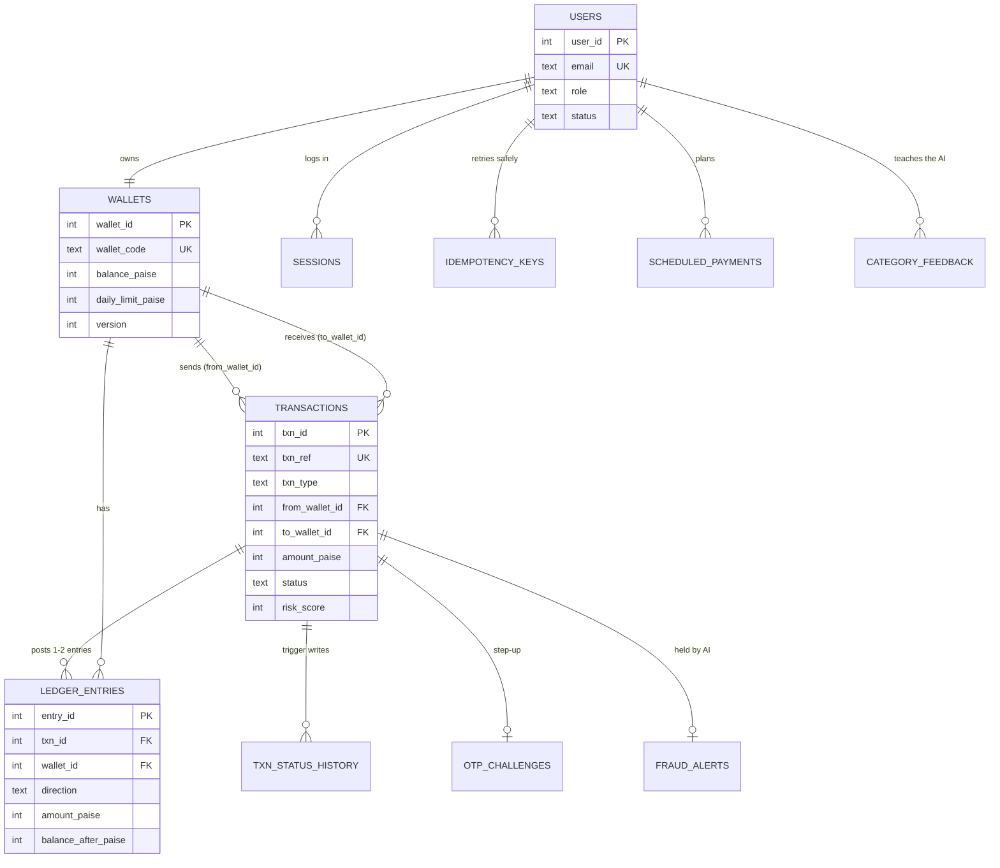

# Architecture

Smart Wallet is a single Flask process with a SQLite database, an optional Redis server, a few background threads and a
no-build JavaScript front end (a phone-width app plus a separate lab console). Everything is plain Python, so every line can be read, explained and demonstrated.

```
Browser (static/js, ES modules)
   |  JSON over HTTP, Bearer token, Idempotency-Key header
   v
Flask blueprints (app/routes)      auth | wallet | ai | oslab | admin
   |
   v
Services (app/services)            WalletService (rules) -> LockManager (OS) -> SQLite transaction (DBMS)
   |                                 cache (LRU/Redis) | rate limiter | audit log (hash chain) | scheduler threads
   v
AI (app/ai)                         fraud engine | categoriser | insights | assistant (+ optional Claude)
```

## 1. Data model (DBMS)



**Design decisions worth explaining**

| Decision | Why |
| --- | --- |
| Money is an `INTEGER` number of paise | Floating point cannot represent 0.10 exactly; integers never drift. |
| `ledger_entries` is append-only (two triggers reject UPDATE and DELETE) | Corrections are new entries, never edits - the audit trail cannot be rewritten. |
| `wallets.balance_paise` is stored although it is derivable from the ledger | Deliberate, documented redundancy for fast reads. The view `v_reconciliation` proves the two always agree. |
| `CHECK (balance_paise >= 0)` | The database itself refuses an overdraft, even if application code has a bug. |
| `CHECK` on `txn_type` with the from/to column combination | A TOPUP has no sender, a WITHDRAW has no receiver, a TRANSFER has two different wallets. Illegal rows cannot exist. |
| `txn_status_history` filled by triggers | A complete life-story of each payment without touching application code. |
| Risk score, reasons and category stored on the transaction | A snapshot of what the AI decided *at that moment*, even if the model changes later. |

**Normal forms.** Every table is in 3NF: each non-key column depends on the key, the whole key and nothing but the key.
The only intentional redundancies are `wallets.balance_paise` and `ledger_entries.balance_after_paise` (running balances),
both guarded by the reconciliation view.

**Indexes.** `idx_txn_from (from_wallet_id, created_at)` and `idx_txn_to` serve the history and the 24-hour limit
queries; `idx_ledger_wallet (wallet_id, entry_id)` serves the passbook. `python manage.py sql sql/queries.sql` (query Q13)
shows the planner choosing the index.

**ACID in this project**

| Property | How |
| --- | --- |
| Atomicity | `db.tx()` = `BEGIN IMMEDIATE ... COMMIT`, any exception rolls back, so debit + credit + status change happen together or not at all. |
| Consistency | `CHECK`, `UNIQUE`, `FOREIGN KEY`, triggers, and the reconciliation view. |
| Isolation | `BEGIN IMMEDIATE` takes SQLite's write lock up front, so two money movements never interleave (serialisable). WAL mode lets readers continue meanwhile. |
| Durability | WAL journal. `synchronous=NORMAL` is a speed/safety trade-off (a power cut can lose the very last commit but never corrupts the file); use `FULL` for maximum durability. |

## 2. Life of a payment (`POST /api/wallet/transfer`)

```mermaid
sequenceDiagram
    participant B as Browser
    participant R as Route (wallet.py)
    participant S as WalletService
    participant F as FraudEngine
    participant L as WalletLocks
    participant D as SQLite
    B->>R: amount, to, note + Idempotency-Key
    R->>R: rate limit (10/min/user) and idempotency lookup
    R->>S: submit()
    S->>S: validate amount, recipient, limits; AI picks a category
    S->>F: assess(context) -> score 0-100 + reasons
    alt score >= 70
        S->>D: txn BLOCKED + fraud_alert (no money moves)
    else score >= 35 or amount >= 5,000
        S->>D: txn PENDING_OTP + hashed OTP
        B->>R: /transfer/confirm (OTP)
    else
        S->>L: hold(from, to) in ascending wallet id
        L->>D: BEGIN IMMEDIATE
        S->>D: re-check balance + daily limit INSIDE the lock
        S->>D: debit, credit, ledger entries, status SUCCESS
        D-->>S: COMMIT
        S->>S: invalidate cached balances (still holding locks)
        L-->>S: release locks
    end
    S->>S: append to the hash-chained audit log
    R-->>B: JSON (201 / 202 / 403 / 409) + store response under the idempotency key
```

Why the re-check inside the lock? Between the first check and the actual write another request could have spent the
money (a check-then-act race). Validating *after* taking the locks and *inside* the transaction closes that gap.

## 3. Operating-system parts

| Topic | What the project does | Where | See it live |
| --- | --- | --- | --- |
| Mutual exclusion | One lock per wallet, so two payments never edit one balance together | `services/locks.py` `LockManager.acquire` | OS lab / Overview |
| Deadlock prevention | Locks are always taken in ascending wallet id: no circular wait is possible | `LockManager.hold(ordered=True)`, `WalletLocks.hold` | OS lab / Deadlock (ordered) |
| Deadlock detection + recovery | Wait-for graph, cycle search, victim = fewest locks held, victim aborts and retries | `find_cycle`, `break_deadlock`, `start_detector` | OS lab / Deadlock (request order) |
| Distributed lock | `SET key token NX PX ttl` and a token-checked release script (Lua) | `RedisLock` | needs Redis |
| Producer / consumer | Dispatcher thread -> priority queue -> worker threads | `services/scheduler.py` | Scheduled tab + OS lab / Overview |
| CPU scheduling | FCFS, SJF, SRTF, Priority, Round Robin with Gantt chart and averages | `services/ossim.py` `simulate_cpu` | OS lab / CPU scheduling |
| Memory management | LRU cache for balances; FIFO / LRU / Optimal page replacement simulator, Belady's anomaly | `services/cache.py`, `ossim.py` `simulate_paging` | OS lab / Memory |
| File system | Append-only audit file, `fsync`, hash chain, SQLite online backup, `os.stat` (permissions, inode) | `services/audit.py`, `services/oslab.py` | OS lab / Files and audit (admin) |
| Processes and threads | PID, thread list, load average, peak memory | `services/oslab.py` `system_info` | OS lab / Overview |
| Concurrency testing | N threads x M transfers; the total money must not change | `oslab.stress_test`, `tests/test_os.py` | OS lab / Stress test |

Lock order and SQLite together: the per-wallet locks stop two *threads or processes* from even *starting* conflicting
work; `BEGIN IMMEDIATE` is the final safety net inside the database. Redis locks extend the first layer across several
server processes.

## 4. AI parts

**Fraud / risk engine** (`ai/fraud.py`) - every outgoing payment gets a score from 0 to 100:

* *Rules* give plain-English reasons: sends most of the balance, much bigger than usual, first payment to this
  recipient, recipient wallet younger than a day, many payments in 10 minutes, late night, near the daily limit,
  wrong OTPs recently, several payments just under the OTP limit ("structuring").
* *Isolation Forest* (scikit-learn) learns what normal payments look like from 1,500 synthetic normal payments plus every real
  successful payment in the database, then scores how unusual a new payment is. It needs no labelled fraud examples.
* `score = 0.7 x rule points + 0.3 x ML anomaly`. **Low** < 35 passes, **Medium** 35-69 needs an OTP, **High** >= 70 is held
  for an administrator (human in the loop). Without scikit-learn a simple statistical fallback is used.

**Categoriser** (`ai/categorizer.py`) - Multinomial Naive Bayes written from scratch on words + character trigrams, so
"swigy" and "bijli bill" work. A correction in the passbook calls `learn()` (online learning) and is stored in
`category_feedback`, so the model re-learns it after a restart.

**Insights** (`ai/insights.py`) - EWMA + same-weekday forecast, spending spikes (mean + 2 sigma), recurring-payment
detection (same payee and amount every ~7 or ~30 days), and a 0-100 health score from savings rate, balance runway,
spending stability and payment safety.

**Assistant** (`ai/assistant.py`) - rule-based intent detection in English and Hinglish answers from the user's own data.
"Rohan ko 500 bhejo" only *pre-fills* the Send form - the assistant has no way to move money. If `ANTHROPIC_API_KEY` is set,
open-ended questions are sent to Claude together with a compact summary of the user's own numbers; transaction notes are
treated as untrusted text. Without a key (or if the call fails) the offline answers are used.

## 5. Front end and the live trace

* **No framework, no build step.** Plain ES modules served by Flask. `ui.js` provides an auto-escaping `html` tagged template (every
  interpolated value is HTML-escaped unless it is itself an `html` result), so dynamic text cannot inject markup.
* **Two shells.** The *app* is a phone-width frame (full screen on phones, a centred frame on laptops) with a bottom tab bar,
  bottom sheets, a keypad and hash routes (`#/home`, `#/pay/<wallet>`, `#/txn/<ref>` ...). The *lab console* (`#/lab/...`, `#/admin`) is a
  separate full-width dark UI for the OS demonstrations and admin tools. `css/app.css` and `css/console.css` never leak into each other.
* **Payment flow** (`flow.js`): preview -> AI-shield review sheet (six checks derived from the rule codes the server returns) -> confirm
  with an `Idempotency-Key` -> optional OTP step (6 boxes, paste support, countdown) -> result. Every step reuses the same API the
  tests exercise.
* **Under the hood.** `services/trace.py` is a tiny recorder: each payment request collects steps (`API`, `AI`, `OS`, `DBMS`, `CACHE`,
  `FILE`) with millisecond offsets, e.g. *Wallet locks taken -> BEGIN IMMEDIATE -> Ledger posted -> COMMIT -> Balance cache
  invalidated -> Audit record appended*. The steps travel in the JSON response as `trace`; `hood.js` animates them and polls
  `/os/overview` and `/os/audit/verify` for live counters. An idempotent replay returns the stored trace of the original request.
* **Design.** "Neel" (indigo dye) theme: one signature object (the wallet card with a jaali lattice and gold chip), turmeric-gold accent,
  Bricolage Grotesque for numbers and headings, light and dark themes via CSS variables, reduced-motion support, focus rings,
  44px+ touch targets. The QR code is generated in the browser by the vendored MIT `qrcode-generator` library.
* **Tests.** The API and AI are covered by pytest; `tests/ui_smoke.py` drives real Chromium through login, payments, the OTP step, the AI
  hold and admin approval, Ask AI, the lab console and the phone layout.

## 6. Security notes

* Passwords: PBKDF2-SHA256 (Werkzeug). Session tokens and OTPs are stored only as hashes. Login runs the same hashing work
  for unknown emails, so response time does not reveal which emails exist.
* Every query is parameterised; the only dynamic SQL assembles fixed fragments. The front end escapes all dynamic text.
* CSV export neutralises spreadsheet formula injection (`=`, `+`, `-`, `@`).
* Rate limits on login, registration, payments, look-ups and chat. Idempotency keys make retries safe.
* Security headers (CSP, frame denial, nosniff) are set on every response.
* **Demo-only shortcuts:** OTPs are printed to the console (and returned to the browser while `DEMO_MODE=true`); the session
  token lives in `sessionStorage`. A production system would send SMS, use HttpOnly cookies with CSRF protection, and
  run on PostgreSQL behind HTTPS.
